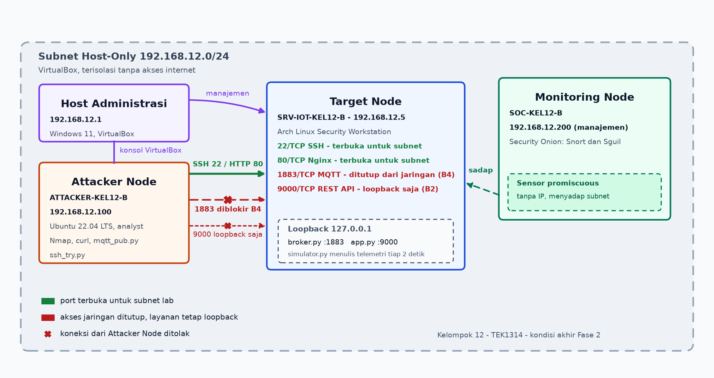

# TEK1314-2026-Kel-12-Kelas-B

Repositori dokumentasi, konfigurasi, dan artefak pengujian keamanan sistem IoT **SmartCow**, yaitu pengendali sprinkler otomatis kandang sapi perah. Sistem asli memakai enam sensor suhu DS18B20 dan empat sensor kelembapan DHT22 pada dua mikrokontroler ESP32, backend Firebase Realtime Database, web dashboard, serta aktuator solenoid 220V berbasis relay.

Untuk praktikum keamanan siber, seluruh arsitektur backend direplikasi ke lingkungan laboratorium virtual terisolasi pada subnet `192.168.12.0/24`, lalu diterapkan hardening bertingkat pada Target Node. Seluruh pengujian memakai data sintetis (dummy) dan tidak menyentuh perangkat kandang mitra maupun layanan Firebase produksi.

## Anggota Kelompok

| No | Nama | NIM | Peran |
| :--- | :--- | :--- | :--- |
| 1 | Thevan Erlangga | J0404241073 | Lead, Purple Team |
| 2 | Muhamad Akhdan Ramadhan | J0404241102 | Red Team |
| 3 | Fachri Abyasa Tarid | J0404241136 | Blue Team |

## Daftar Isi

1. [Ringkasan Proyek](#ringkasan-proyek)
2. [Peta Berkas Repositori](#peta-berkas-repositori)
3. [Alur Penelusuran Dokumen](#alur-penelusuran-dokumen)
4. [Akses Lingkungan Lab](#akses-lingkungan-lab)
5. [Ruang Lingkup dan Batasan](#ruang-lingkup-dan-batasan)

## Ringkasan Proyek

- **Lingkungan Uji:** Tiga mesin virtual terisolasi pada jaringan Host-Only `192.168.12.0/24`.
- **Pertahanan Blue Team:** Sepuluh kontrol pengamanan aktif, terdiri atas tiga kontrol Access, empat Service, dan tiga Data/Application.
- **Pengujian Red Team:** Empat skenario, yaitu pemetaan port (RT-01), brute force SSH (RT-02), injeksi REST dan publish MQTT ilegal (RT-03), serta replay pesan kendali (RT-04).
- **Validasi Purple Team:** Siklus lima tahap berbasis sensor Snort/Sguil dan audit log lokal.
- **Kondisi Akhir Port:** Setelah kontrol B4, hanya port 22 (SSH) dan 80 (HTTP) terbuka bagi segmen lab. Port 1883 (MQTT) ditutup dari jaringan, dan port 9000 (REST API) hanya melayani loopback.
- **Integritas Pengujian:** Seluruh data uji bersifat dummy; tidak ada kredensial produksi di repositori.

*Gambar 1. Topologi kondisi akhir Fase 2. Hanya port 22 (SSH) dan 80 (HTTP) terbuka bagi segmen lab; port 1883 (MQTT) ditutup dari jaringan oleh B4 dan port 9000 (REST API) hanya melayani loopback setelah B2. Snapshot kondisi Minggu 9, saat 1883 masih dibuka, tersedia pada [topology-minggu9.png](docs/design/topology-minggu9.png).*

## Peta Berkas Repositori

| Dokumen atau Folder | Isi |
| :--- | :--- |
| [LOGBOOK.md](LOGBOOK.md) | Kronologi teknis mingguan, dari pembentukan tim sampai verifikasi ulang Fase 2 |
| [docs/design/ip_plan.md](docs/design/ip_plan.md) | Skema pengalamatan IP, peran node, dan alokasi port layanan |
| [docs/design/topology-akhir-fase2.png](docs/design/topology-akhir-fase2.png) | Diagram topologi kondisi akhir Fase 2 (22 dan 80 terbuka, 1883 dan 9000 loopback) |
| [docs/design/topology-minggu9.png](docs/design/topology-minggu9.png) | Snapshot diagram topologi jaringan lab Minggu 9, saat 1883 masih dibuka |
| [docs/blueteam/baseline-report.md](docs/blueteam/baseline-report.md) | Baseline report Fase 1 (Minggu 7): aset, hardening awal, dan bukti logging |
| [docs/blueteam/hardening_checklist.md](docs/blueteam/hardening_checklist.md) | Sepuluh kontrol hardening (A1-A3, B1-B4, C1-C3) beserta bukti verifikasi |
| [docs/blueteam/evidence/](docs/blueteam/evidence/) | Tangkapan layar dan log before/after, baseline, serta verifikasi kontrol |
| [docs/blueteam/evidence/verifikasi-ulang/README.md](docs/blueteam/evidence/verifikasi-ulang/README.md) | Indeks bukti teks verifikasi ulang Fase 2 |
| [docs/redteam/attack_plan.md](docs/redteam/attack_plan.md) | Rancangan skenario serangan RT-01 sampai RT-04 |
| [docs/redteam/evidence/](docs/redteam/evidence/) | Bukti eksekusi pengujian penyerangan dan keluaran Nmap |
| [docs/purple-team-log.md](docs/purple-team-log.md) | Siklus lima tahap Purple Team dan evaluasi deteksi |
| [docs/vulnerability-assessment-report.md](docs/vulnerability-assessment-report.md) | Vulnerability Assessment Report Fase 2: enam temuan, kontrol, dan kesimpulan |
| [docs/presentation-minggu9/README.md](docs/presentation-minggu9/README.md) | PDF dan pratinjau delapan slide checkpoint Minggu 9 |
| [docs/presentation-minggu9/tech_stack_declaration.md](docs/presentation-minggu9/tech_stack_declaration.md) | Deklarasi arsitektur teknologi asli dan pemetaannya ke lab |
| [scripts/smartcow-lab/README.md](scripts/smartcow-lab/README.md) | Kode replika backend lab: REST API, broker MQTT, simulator, unit systemd |

## Alur Penelusuran Dokumen

Urutan berikut memudahkan pembaca baru menelusuri bukti dari rancangan sampai hasil:

1. [ip_plan.md](docs/design/ip_plan.md) - Rancangan topologi, subnetting, dan fungsi setiap mesin virtual.
2. [baseline-report.md](docs/blueteam/baseline-report.md) - Kondisi awal setelah hardening Fase 1 dan bukti logging Minggu 5.
3. [tech_stack_declaration.md](docs/presentation-minggu9/tech_stack_declaration.md) - Arsitektur SmartCow dan dasar pemilihan replika backend lab.
4. [hardening_checklist.md](docs/blueteam/hardening_checklist.md) - Implementasi sepuluh kontrol Blue Team pada Target Node.
5. [attack_plan.md](docs/redteam/attack_plan.md) dan [purple-team-log.md](docs/purple-team-log.md) - Skenario penyerangan serta evaluasi deteksi di Security Onion.
6. [vulnerability-assessment-report.md](docs/vulnerability-assessment-report.md) - Rekap enam temuan, status mitigasi, dan kesiapan Fase 3.
7. [verifikasi-ulang/README.md](docs/blueteam/evidence/verifikasi-ulang/README.md) - Hasil verifikasi ulang kontrol Fase 2 beserta bukti teksnya.

## Akses Lingkungan Lab

| Peran | Alamat IP | Pengguna | Metode Akses |
| :--- | :--- | :--- | :--- |
| Target Node | 192.168.12.5 | `sec_admin` | Kunci SSH Ed25519; login kata sandi dinonaktifkan |
| Attacker Node | 192.168.12.100 | `analyst` | Konsol VirtualBox atau SSH dengan kunci |
| Monitoring Node | 192.168.12.200 | `analyst` | Konsol, Sguil, dan SSH dengan kunci |

Kata sandi lingkungan lab tidak disimpan di repositori. Pada verifikasi ulang Fase 2 jalur kata sandi SSH ditutup di ketiga node (`PasswordAuthentication no`), sehingga hanya autentikasi `publickey` yang diterima. Ketiga alamat terverifikasi saling terhubung pada sesi yang sama (`docs/blueteam/evidence/verifikasi-ulang/03-topology-reachability.log`).

Kata sandi akun sistem sengaja tidak dirotasi karena masih dipakai untuk login konsol dan Sguil pada panduan demo. Selama jalur SSH berbasis kata sandi tertutup, nilai tersebut tidak dapat dipakai masuk dari jaringan; rotasi tetap menjadi keputusan pemilik lab (`docs/blueteam/evidence/verifikasi-ulang/15-ssh-password-auth-disabled.log`).

## Ruang Lingkup dan Batasan

Repositori ini mengikuti struktur direktori Panduan PBL Minggu 9: `docs/design`, `docs/presentation-minggu9`, `docs/blueteam`, `docs/redteam`, dan `docs/purple-team-log.md`. Naskah presentasi, lembar catatan latihan, dan prosedur pengujian insiden disimpan pada direktori kerja internal kelompok di luar repositori publik ini.

Setiap pernyataan teknis disertai tangkapan layar atau berkas log asli. Pemeriksaan ulang menemukan dua tangkapan layar lama yang isinya justru memperlihatkan kegagalan perintah, yaitu `mqtt-acl-terverifikasi.png` pada kontrol C1 dan salinan lama `backup-dan-pemulihan-data.png` pada kontrol C3. Keduanya tidak dipakai lagi. C1 kini dibuktikan log eksekusi `docs/blueteam/evidence/verifikasi-ulang/01-c1-live-verification.log` beserta tangkapan layar penolakan publish, sedangkan C3 memakai tangkapan layar pengganti `backup-dan-pemulihan-data.png` yang memuat eksekusi nyata (unit backup `Succeeded`, `PASS archive-checksum`, `PASS manifest 4/4`) dan diperkuat log `02`, `07`, serta `13`. Status penggantian dicatat pada `hardening_checklist.md`.
