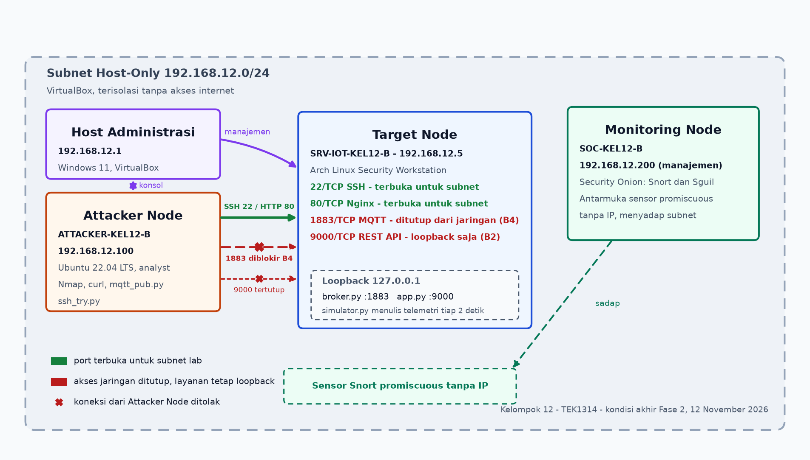
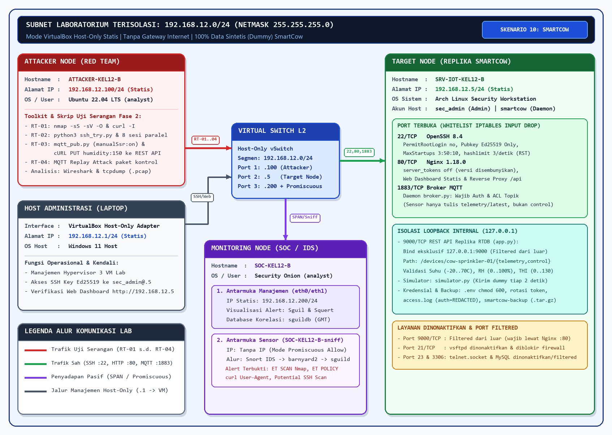

# Skema Pengalamatan IP - Kelompok 12 Kelas B

**Subnet Laboratorium:** `192.168.12.0/24`  
**Netmask:** `255.255.255.0`  
**Mode Jaringan VirtualBox:** Host-Only dengan IP statis pada seluruh node untuk menjamin isolasi lingkungan pengujian (tanpa mode Bridged).

## Daftar Isi

- [Alokasi Alamat dan Peran Node](#alokasi-alamat-dan-peran-node)
- [Diagram Topologi](#diagram-topologi)
- [Layanan pada Target Node](#layanan-pada-target-node)
- [Diagram Alur Komunikasi](#diagram-alur-komunikasi)
- [Catatan Teknis](#catatan-teknis)

## Alokasi Alamat dan Peran Node

| Nama Host | Alamat IP | Peran Fungsional | Sistem Operasi | Layanan dan Keterangan |
| :--- | :--- | :--- | :--- | :--- |
| `SRV-IOT-KEL12-B` | 192.168.12.5 | Target Node (replika backend IoT) | Arch Linux Security Workstation | SSH 22, dashboard Nginx 80, broker MQTT 1883 (kini hanya loopback), REST API 9000 (loopback) |
| `ATTACKER-KEL12-B` | 192.168.12.100 | Attacker Node | Ubuntu 22.04 LTS (Cisco LabVM) | Nmap, tcpdump, Wireshark, dan skrip pengujian Python |
| `SOC-KEL12-B` | 192.168.12.200 | Monitoring Node (manajemen) | Security Onion | Antarmuka manajemen aplikasi Sguil dan Squert |
| `SOC-KEL12-B-sniff` | Tanpa IP (promiscuous) | Monitoring Node (sensor) | Security Onion | Menangkap dan menganalisis lalu lintas `192.168.12.0/24` |
| Host Administrasi | 192.168.12.1 | Host administrasi | Windows | Manajemen hypervisor VirtualBox dan pengujian akses web |

## Diagram Topologi



*Gambar 1. Kondisi akhir Fase 2 per 12 November 2026. Port 22 dan 80 terbuka bagi segmen lab, port 1883 ditutup dari jaringan oleh B4, dan port 9000 hanya melayani loopback setelah B2.*


*Gambar 2. Snapshot Minggu 9. Diagram ini masih mencantumkan 1883/TCP pada whitelist firewall; kontrol B4 menutup akses tersebut pada 12 November 2026. Sumber gambar: [topology-minggu9.excalidraw](topology-minggu9.excalidraw).*



*Gambar 3. Rancangan awal Minggu 4 di Cisco Packet Tracer. Alamat `.100`, `.5`, dan `.200` sudah mengikuti rencana, tetapi Target digambarkan sebagai Metasploitable atau DVWA dengan port 80, 443, dan 3306. Implementasi lab memakai Arch Linux dengan layanan SmartCow pada port 22, 80, 1883, dan 9000.*

## Layanan pada Target Node

| Port / Protokol | Layanan | Status Akses Setelah Hardening | Fokus Pengujian Keamanan |
| :--- | :--- | :--- | :--- |
| 22/TCP | OpenSSH | Terbuka hanya untuk `192.168.12.0/24`; autentikasi kunci, login root ditolak, pembatasan laju koneksi aktif | Percobaan login berulang dan ketahanan pembatasan koneksi |
| 80/TCP | Nginx (dashboard dan proxy) | Terbuka untuk `192.168.12.0/24`; banner versi disembunyikan; rute `/api` diteruskan ke loopback | Kebocoran versi dan manipulasi data melalui API |
| 1883/TCP | Broker MQTT | Ditutup dari jaringan lewat B4 (12 November 2026); hanya loopback yang lolos; otentikasi dan ACL topik wajib | Publish tanpa hak akses dan perlindungan kanal kontrol |
| 9000/TCP | REST API replika | Hanya pada `127.0.0.1` (kontrol B2), tidak dapat dihubungi dari jaringan | Validasi rentang data sensor dan otentikasi token bearer |

Port yang tidak digunakan, yaitu 21 (FTP), 23 (Telnet), dan 3306 (MySQL), diblokir firewall dan tidak memiliki listener. Tidak ada layanan lain yang terbuka di luar daftar di atas.

## Diagram Alur Komunikasi

```text
Attacker Node (192.168.12.100)
   |  SSH :22 dan HTTP :80
   |  (1883 dan 9000 tidak dapat dihubungi sejak B2/B4)
   v
Target Node (192.168.12.5)
   |-- sshd         :22     whitelist subnet lab, kunci Ed25519
   |-- Nginx        :80     dashboard + proxy /api
   |       |
   |       +--> 127.0.0.1:9000  app.py (REST API replika)
   |-- broker.py    :1883   hanya loopback
   +-- simulator.py         menulis telemetri dummy tiap 2 detik

Seluruh lalu lintas segmen Host-Only disadap Monitoring Node
(192.168.12.200, NIC sensor promiscuous tanpa IP).
```

## Catatan Teknis

1. Target Node memakai citra Arch Linux Security Workstation dari laboratorium, menggantikan rencana awal Ubuntu Server. Peran operasional dan alokasi port tidak berubah.
2. Attacker Node hanya diarahkan ke `192.168.12.5` dan tidak memiliki rute ke luar segmen laboratorium.
3. Security Onion mengoperasikan dua kartu jaringan virtual: satu antarmuka ber-IP untuk manajemen, dan satu antarmuka tanpa IP bermode promiscuous untuk penyadapan paket.
4. Aturan firewall disimpan permanen pada `/etc/iptables/iptables.rules` dan dimuat saat boot melalui `iptables.service`, sehingga aturan tidak hilang setelah VM dinyalakan ulang.
5. Ketiga node diperiksa ulang pada 12 November 2026 dan merespons ping dari host administrasi tanpa kehilangan paket. Attacker Node memakai alamat statis `192.168.12.100/24` dengan gateway `192.168.12.1`; server DHCP VirtualBox dipindahkan ke rentang `192.168.12.3` sampai `192.168.12.254` agar klien tidak menerima alamat dari subnet lain. Bukti: `../blueteam/evidence/verifikasi-2026-11-12/03-topology-reachability.log` dan `../blueteam/evidence/verifikasi-2026-11-12/04-onion-state.log`.
