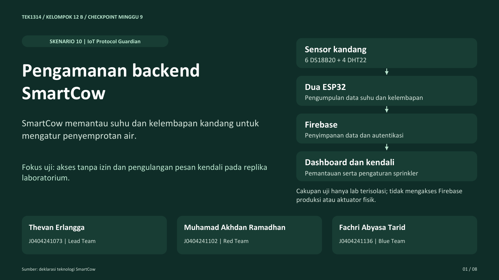
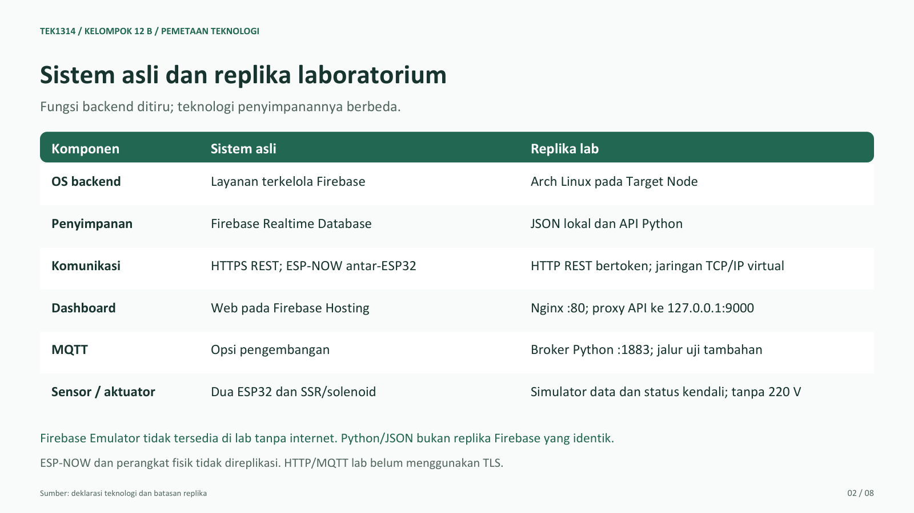
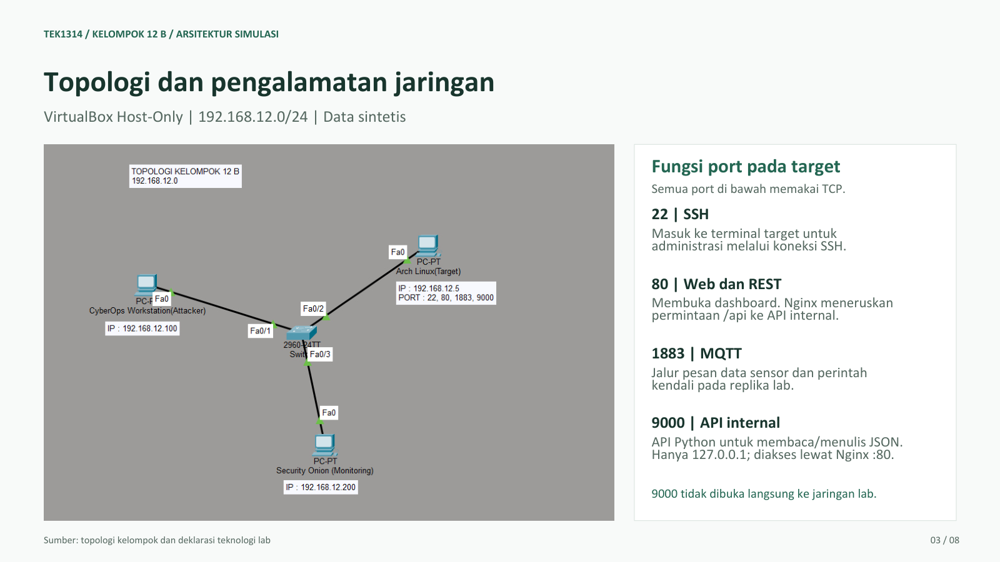
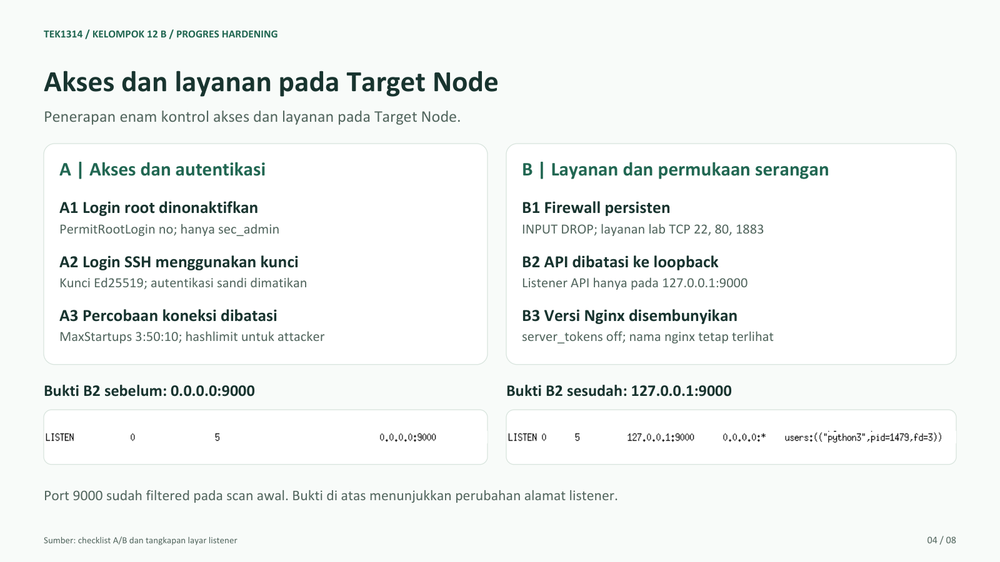
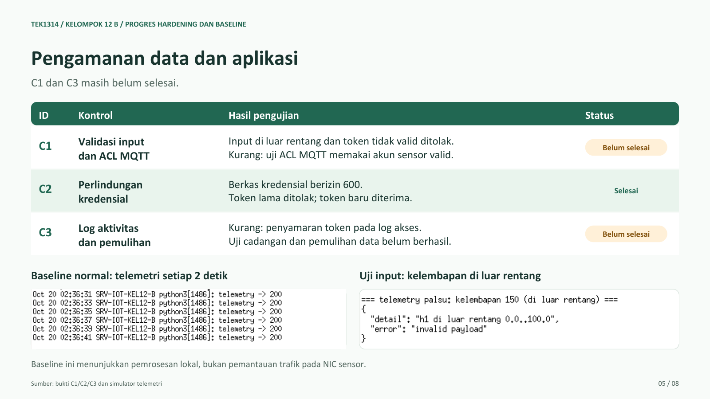
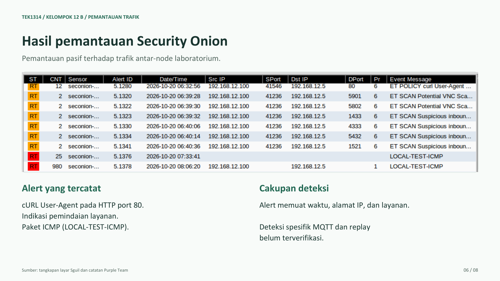
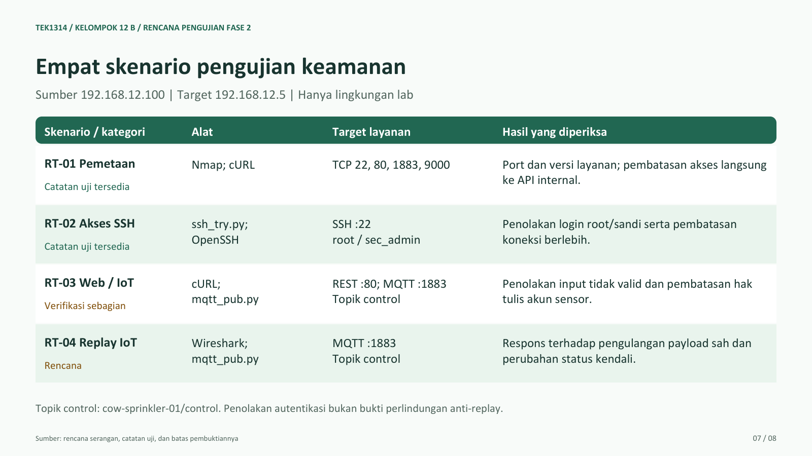
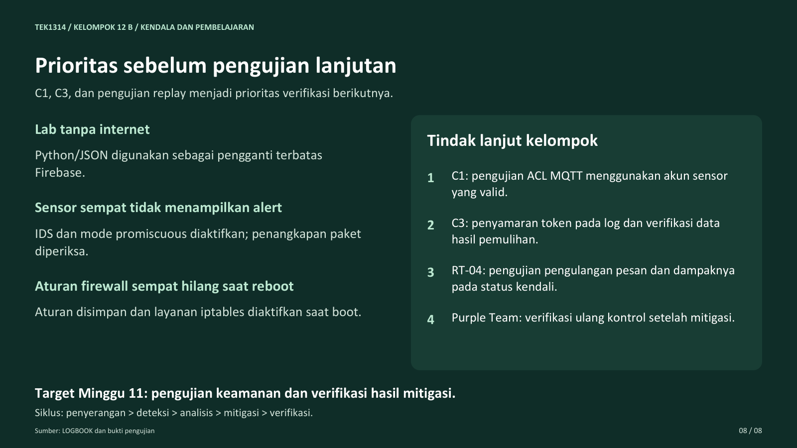

# Presentasi Minggu 9

Delapan slide checkpoint SmartCow, Kelompok 12 Kelas B. Isi presentasi tetap sesuai kondisi pada Minggu 9.

[Buka atau unduh PDF](https://raw.githubusercontent.com/SwipeLz/TEK1314-2026-Kel-12-Kelas-B/main/docs/presentation-minggu9/slides.pdf).

Jika pratinjau PDF di GitHub tidak terbuka, seluruh slide dapat dibaca sebagai gambar di bawah ini.

## Slide 1

## Slide 2

## Slide 3

## Slide 4

## Slide 5

## Slide 6

## Slide 7

## Slide 8

