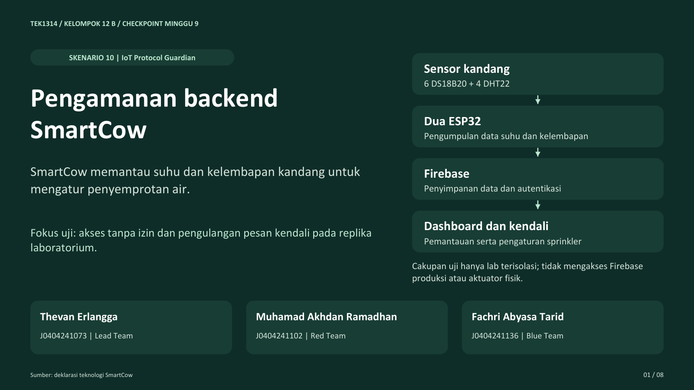
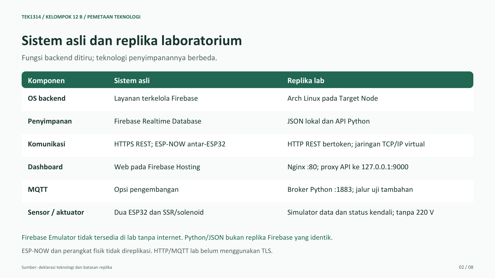
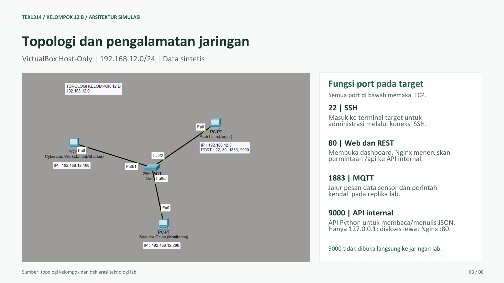
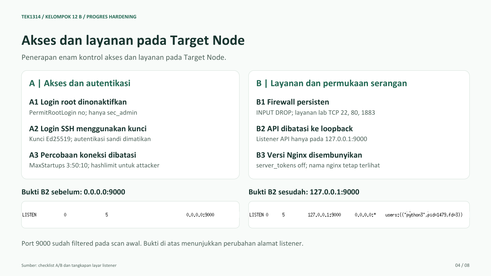
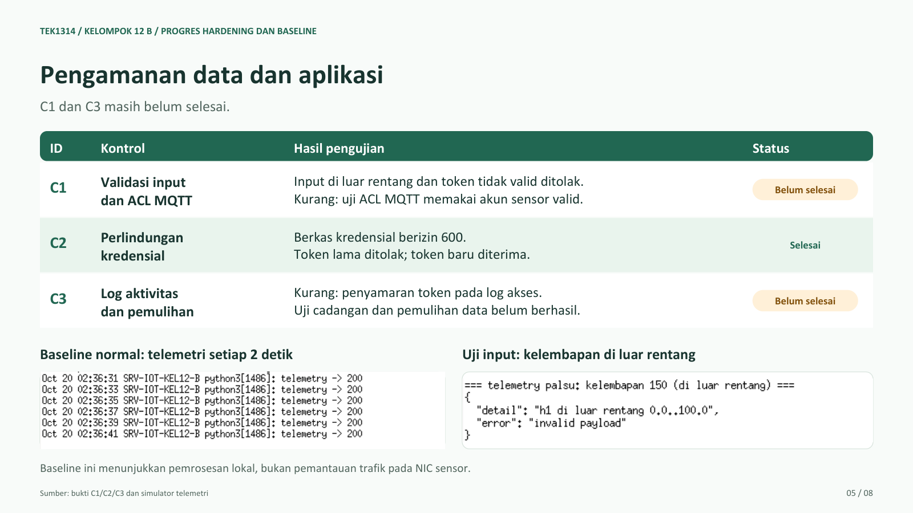
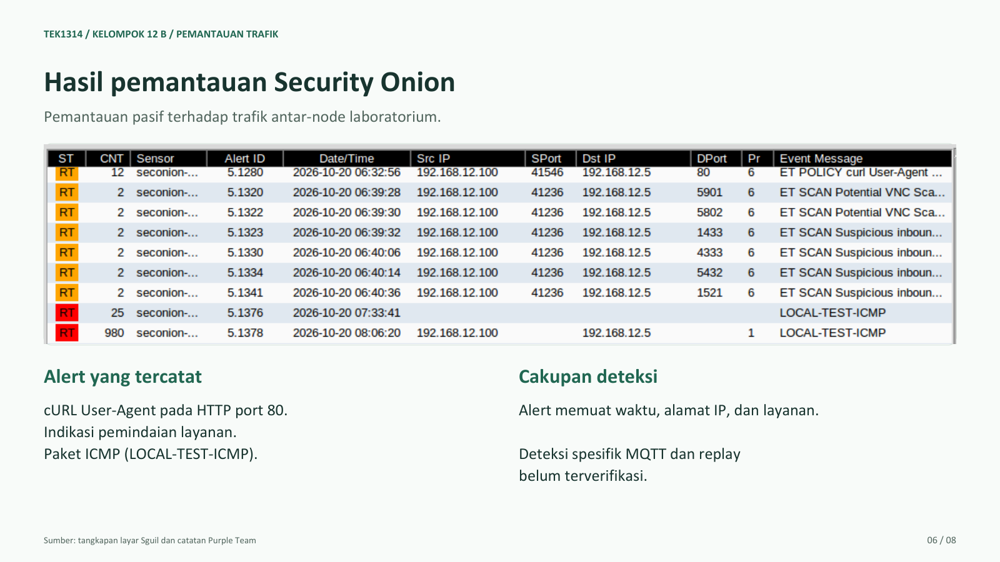
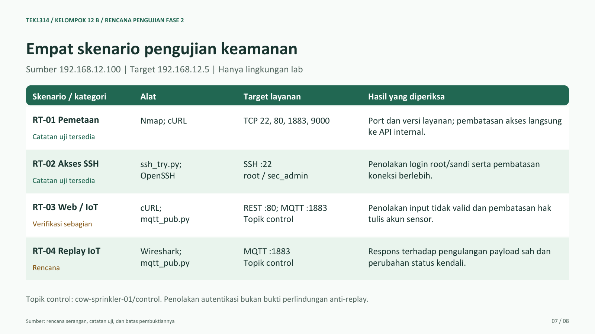
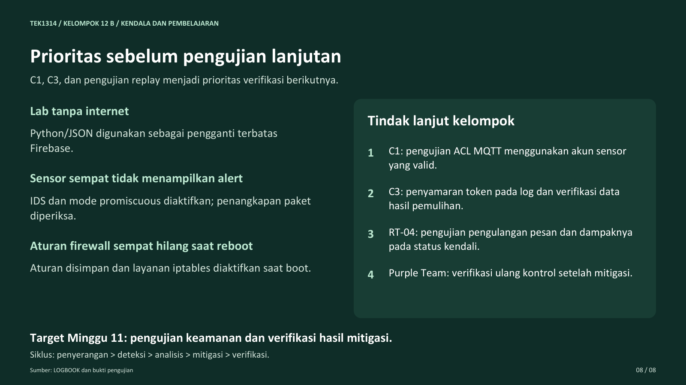

# Presentasi Minggu 9

Delapan slide checkpoint SmartCow, Kelompok 12 Kelas B. Isi presentasi mengikuti kondisi pada Minggu 9 dan tidak diperbarui setelah Fase 2 selesai.

[Buka atau unduh slides.pdf](slides.pdf)

Jika pratinjau PDF di GitHub tidak terbuka, seluruh slide dapat dibaca sebagai gambar di bawah ini. Setiap gambar memakai jalur `preview/slide-0N.png`.

## Daftar Slide

1. [Slide 1: Pengantar SmartCow dan anggota tim](#slide-1)
2. [Slide 2: Pemetaan sistem asli ke replika lab](#slide-2)
3. [Slide 3: Topologi dan layanan jaringan lab](#slide-3)
4. [Slide 4: Pengamanan akses dan layanan](#slide-4)
5. [Slide 5: Status pengamanan data dan aplikasi](#slide-5)
6. [Slide 6: Hasil pemantauan Security Onion](#slide-6)
7. [Slide 7: Rencana dan status pengujian Red Team](#slide-7)
8. [Slide 8: Pekerjaan lanjutan menuju Fase 2](#slide-8)

## Slide 1

Pengantar SmartCow dan anggota tim.

## Slide 2

Pemetaan sistem asli ke replika laboratorium.

## Slide 3

Topologi dan layanan jaringan laboratorium.

## Slide 4

Pengamanan akses dan layanan.

## Slide 5

Status pengamanan data dan aplikasi.

## Slide 6

Hasil pemantauan Security Onion.

## Slide 7

Rencana dan status pengujian Red Team.

## Slide 8

Pekerjaan lanjutan menuju Fase 2.

